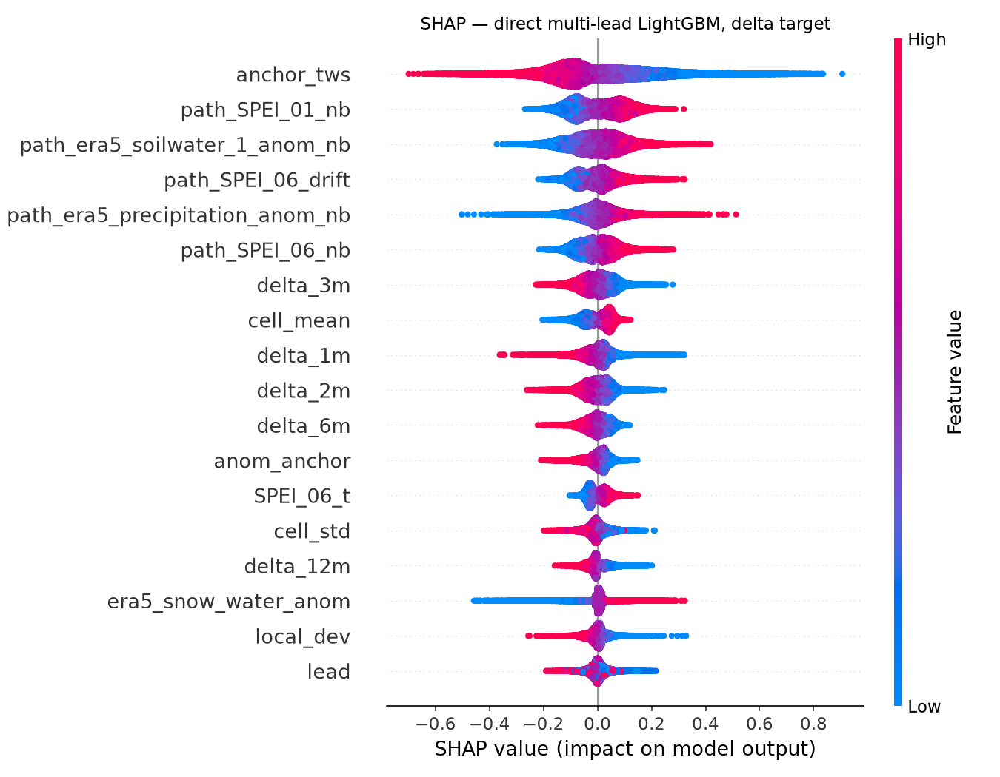

# A Step Ahead of Drought: Phase Two Report

Team: nhatvo. Private leaderboard rank 6 (public RMSE 0.662143, private RMSE 0.700299).
Long technical report: `report/REPORT.md`. The working log (`NOTES.md`, `research/results.jsonl`) is not published.

## Solution summary

The submitted file blends 14 base prediction files in 19 linear steps. The main model is one
LightGBM regressor for all seven leads. It predicts the change from the last observed TWS value
(the anchor), with lead as a feature. Its 75 features are anchor and lag terms, 500 km
neighbourhood means, SPEI, soil moisture and ERA5 anomalies. The other members are an earlier
LightGBM without ERA5, a LightGBM with no TWS inputs, DART and linear-tree variants, a
recursive rollout, an EOF rollout, two MLP bags, climatology, neighbourhood persistence, a
persistence variant and two small convolutional models of the global TWS field. We solved the
blend weights from public leaderboard scores, not from a validation set. So the weights partly
fit the public 30% of rows. From `MAUBvhPi` to the final file, 79% of the public gain reached
the private board.

## 1. Data & Model Bias

Error is unequal across regions. Skill (1 minus RMSE divided by target spread) is 0.10 at 30 to
60°S and 0.34 at 0 to 15°S. Bias is -0.16 at 30 to 60°S and +0.10 north of 60°N. Calm cells
have the lowest RMSE (0.43) but low skill (0.22). We measured this with an error decomposition
of the main model on a forward holdout (`artifacts/bias_tables.md`). We did not use AI Fairness
360, because its group metrics assume classification. Two biases remain. Skill falls from 0.45
(2012) to 0.23 (2015) as training data ages. Leaderboard-derived blend weights add selection bias.

## 2. Model Transparency

We used SHAP (TreeExplainer, 40,000 rows) on the main 75-feature LightGBM model. The anchor
`TWS_t` is the top feature, at 11.6% of mean |SHAP|. By group, ERA5 forcing leads (30.1%), then
SPEI (21.9%), anchor terms (18.8%) and TWS lags (13.5%). Supplied soil moisture is only 2.2%. The
signs show mean reversion: a high anchor or a recent rise lowers the predicted change. Wet
neighbourhood soil and rain raise it. Unexpected: lead is only 1.8% of SHAP, but RMSE rises from
0.56 (lead 1) to 0.72 (lead 4).

## 3. Approach Reusability

The method reads a cell-by-month panel, covariate panels and a neighbourhood graph. Any gridded
variable of that shape can replace TWS. Lead is an input feature, so new leads need only folds
that reach them. An assertion (`assert_no_coordinates`) blocks latitude and longitude as
features, so the model cannot memorise places. The convolutional member uses the same ~7,000
weights at every position. Limitations: the
500 km radius is one global constant. Recursive rollout failed (lead-7 RMSE 0.719 became 1.230),
so leads beyond 7 are untested. A new region has no leaderboard, so blend weights need a
forward-in-time holdout.

## 4. Sustainability and Efficiency

CodeCarbon logged 54 runs (`../research/emissions.csv`): 311.8 g CO2e, 131.1 g on CPU and RAM
only. On our shared machine CodeCarbon charges the whole GPU to our process, so the GPU share
(58%) overstates our use. One full training of the final solution takes about 6 hours and
141 g CO2e (CPU and RAM estimate). The two MLP bags cause 119 g of that. The convolutional
members train for a fixed 30 epochs in under 4 minutes. ERA5 panels load once and stay cached.
Ten times more LightGBM compute barely changed predictions (correlation 0.993), so we kept the
smaller budget.

---

## Reviewer notes (delete before submission)

Word limits: each rubric section is at most 100 words. The solution summary is at most 150.

Sources for every number:

- Ranks and scores: `NOTES.md` §6.98 and §6.99. The 79% transfer figure is §6.99.
- Section 1: `report/artifacts/bias_tables.md`. AI Fairness 360 reasoning: `REPORT.md` §5.1.
- Section 2: `report/artifacts/shap_importance.csv` and `REPORT.md` Appendix B. The 0.45 against
  0.68 ablation: `REPORT.md` §3.1 and §5.2. Lead-4 RMSE 0.7574 is from `bias_tables.md`.
  (`REPORT.md` Appendix B says 0.759. `bias_tables.md` and `NOTES.md` §7.1 say 0.757.)
- Section 3: `REPORT.md` §3.1, §3.2, §3.5 and §5.3.
- Section 4: totals summed from `research/emissions.csv` (54 rows). MLP bag: project
  `tws-mlp-bag8`. Convolutional runs: project `tws-fielddirect2` (8 runs, 1,069 s, 35.50 g).
  Shared-GPU caveat and 20x caching claim: `REPORT.md` §5.4. Ten-times budget test: `NOTES.md`
  §6.87.

Known problems with the current artefacts:

1. `shap_summary.png`, `shap_importance.csv` and `bias_tables.md` were built on 2026-09-01. They
   describe the 45-feature champion from before ERA5. The shipped base model has 75 features.
   No SHAP or bias artefact exists for the final blend or for the convolutional members.
2. `report/artifacts/emissions.csv` holds only 8 runs (9.2 g). `research/emissions.csv` holds
   54 runs (311.8 g). The artefact copy is stale.
3. `REPORT.md` §5.4 says "53 runs", "52% of recorded energy was another project's GPU" and
   "161 g" for CPU and RAM. These figures do not match the current 54-row file. The current file
   gives a GPU share of 58%. No log separates our GPU load from the other project's load.
4. No CodeCarbon row is clearly labelled as the final ERA5 LightGBM production refit.
   `scripts/submit_v2.py` logs under `tws-autoresearch-v2`, which also covers research runs.
5. The "20x less compute" caching claim appears only in `REPORT.md`. No log or result row
   records it.
6. `REPORT.md` §7 still says "rank 15 of 1,374". That is the public rank, not the final rank.
