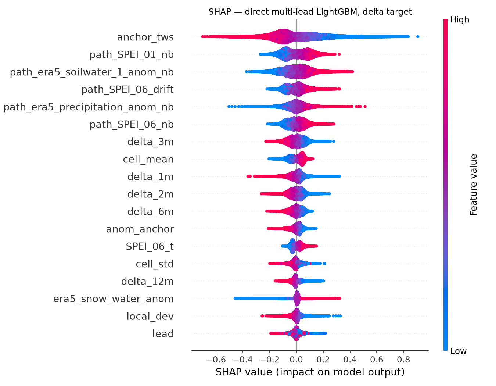

# A Step Ahead of Drought — Forecasting Global Water Storage

**Competition:** ITU / Zindi · closes 2026-09-13
**Code:** this repository · **Working log:** not published

---

## 1. The problem as it is actually posed

The competition frames the task as one-month-ahead prediction of standardised Total Water
Storage (TWS) anomalies on a global land grid — about 15,600 cells, 2,154,021 training rows
over 2002–2015 and 280,961 scored rows over 2015–2018. That framing is incomplete in one way that determines everything else.

`TWS_t` — the previous month's storage, and by a wide margin the strongest single predictor —
is withheld on **66.53%** of test rows, and its absence is exposed as a `TWS_t_masked` column.
Critically, **the masking is per-month, not per-row**: the 18 test months form six runs of
consecutive calendar months (lengths 1, 3, 4, 7, 1, 2), and `TWS_t` is served only on the
first month of each run. We verified this by re-deriving the run structure from `Test.csv`
rather than trusting the description — a row is masked if and only if the same cell's previous
month is also in the test file. That biconditional is exact, not approximate: it agrees on
**280,961 of 280,961 rows**, with zero exceptions in either direction. (The handful of unmasked
rows that appear inside a run are cells whose previous month is absent from the test file
entirely, which the rule already covers.)

So the test set is not a one-month-ahead problem. It is six independent forecast rollouts, and
every row carries an *effective lead* of 1 to 7 months from its run's last observed anchor:

| effective lead | 1 | 2 | 3 | 4 | 5 | 6 | 7 |
|---|---|---|---|---|---|---|---|
| test rows | 93,631 | 62,503 | 46,827 | 31,206 | 15,638 | 15,572 | 15,584 |

Two consequences follow immediately, and both are design decisions rather than tuning:

1. **A validation fold must be an anchor month, not a random row sample.** Neighbouring months
   at one coordinate are nearly identical, so a random split across those 2.15M rows scores about
   0.29 RMSE optimistic — it is measuring interpolation, not forecasting.
2. **A single pooled RMSE is meaningless.** Any fold's lead mix is an artefact of which
   contiguous month runs the GRACE record happens to offer, not of the test set. We score each
   lead separately and reweight to the table above.

## 2. Validation

### 2.1 Construction

We build a dense (cell × month) panel of TWS and covariates. One useful fact recovered here:
`target(cell, t)` equals `TWS_t(cell, t+1)` exactly — zero mismatches over 1,977,398 rows — so
folding the target column back into the panel recovers **11** of the months GRACE is missing,
taking observable months in the training window from **138 to 149**. (An earlier draft said 139
to 149, recovering 10; re-derived here, both were off by one. The test file's unmasked anchors
add nothing further *inside* the training window, since 2015-09 is already reachable as the
2015-08 target.)

A fold is one anchor month `a`. A row at month `a + k − 1` has lead `k` and predicts month
`a + k`. Per-lead MSE is pooled across folds, then combined with the test lead weights. The
bootstrap unit is the **anchor**, never the row: rows sharing an anchor and a cell are not
independent, and treating them as such inflates significance by orders of magnitude.

### 2.2 Calibrating the harness against the leaderboard

Rather than trust the harness, we calibrated it against three model-free submissions whose
public scores are known (published on the competition forum, reproduced by us):

| probe | harness projected | actual public LB | error |
|---|---|---|---|
| all zeros | 1.0138 | 1.013783 | +0.0000 |
| persistence (carry the anchor forward) | 0.8855 | 0.886420 | −0.0009 |
| 0.62 × persistence | 0.8021 | 0.803528 | −0.0014 |

The harness reproduces all three to within 0.0015, and a paired bootstrap over anchors
resolves a 1% shrink of persistence at Δ = −0.00356 with a 95% CI of [−0.00402, −0.00316] —
far below the effect sizes that matter. Two traps were found and fixed during this
calibration: requiring folds to reach lead 7 silently restricted sampling to 2009–2010 and
swung the projection between 0.740 and 0.927, and the ratio-to-zeros rescaling is not
scale-free across eras.

### 2.3 The finding that should have changed our strategy sooner

We then spent two submissions deliberately, not to score, but to measure. The same model was
submitted twice: once trained only to 2009-12 (as validation does) and once refit to the end
of training. A crippled four-feature model was submitted alongside it.

| submission | local weighted RMSE | public LB |
|---|---|---|
| rich model, trained to 2009-12 | 0.6329 | 0.8033 |
| four-feature model, trained to 2009-12 | 0.6881 | 0.8046 |
| rich model, refit to 2015-09 | — | 0.7165 |

**A 0.055 local gap collapsed to 0.0013 on the leaderboard, while refitting alone was worth
0.087.** The feature search that followed (eight screen-and-confirm rounds, three promotions)
improved local RMSE by 0.0129 and the leaderboard by 0.0014 — a **transfer ratio of about
0.11**, with the local gain confirmed at t = 26.9 across five held-out fold seeds.

The local gain is real and reproducible; it simply does not survive the move to
2016–2018. Skill from rich features is regime-dependent, and the dominant term in leaderboard
performance is how recently the model was fitted, not how good its features are.

We report this because it is the single most useful thing we learned, and because it is the
kind of result a leaderboard-only writeup would hide.

### 2.4 The harness reproduces levels and compresses differences

Section 2.2 shows the harness reproducing three known public scores to within 0.0015, which is
a real result and a narrower one than it looks. It calibrates **RMSE levels** on model-free
probes. It says nothing about whether the harness reproduces the *correlations* that decide
which candidate is better — and it does not.

Every predictor we can measure both ways understates:

| predictor | local corr | board-implied corr | ratio |
|---|---|---|---|
| champion | 0.6775 | 0.7251 | 1.07 |
| neighbourhood persistence | 0.5364 | 0.6249 | 1.16 |
| seasonal climatology | −0.2601 | −0.5009 | **1.93** |

The board-implied figures come from the moment identity of Section 7 and involve no fitting.
The distortion is **multiplicative and grows with distance from the fitted model**: the champion
is nearly right, and climatology — the predictor whose behaviour differs most between the
2012–2015 holdout and the 2016–2018 test period — is off by almost a factor of two.

This is the mechanism behind Section 2.3's transfer ratio of 0.11, and it carries a warning we
would give to anyone calibrating a harness this way. **Agreement on levels is not agreement on
ordering.** Three probes matching to 0.0015 built justified confidence in the harness's
arithmetic and unjustified confidence in its judgement, and the gap between those two things
cost us most of a feature search. A validation surface should be calibrated on the quantity the
decisions actually use — here, differences between candidates — and the cheapest way to do that
is to spend two submissions measuring a difference you already believe in, as Section 2.3 did.

### 2.5 The defect calibration could not see: the estimand drifts

Section 2.4 concluded that agreement on levels is not agreement on ordering. That was right and
still not the whole defect, and finding the rest of it cost a submission: a two-member blend
that the harness priced at **+0.006** scored **−0.010**, a miss of 0.016 in a quantity whose
standard error we believed was 0.0005.

The diagnosis is not noise. Resampling whole anchor months — which keeps each month's spatial
correlation structure intact and so needs no degrees-of-freedom correction — gives the two new
members t = 6.4 and t = 4.0. They are locally real. What is not constant is *when* they are
real. Breaking the same measurement down by anchor month:

| member | pooled, 27 anchors | last 6 anchors | slope per year | t |
|---|---|---|---|---|
| recursive rollout | +0.00324 | +0.00184 | +0.00071 | 1.15 |
| **EOF field projection** | **+0.00257** | **−0.00011** | **−0.00326** | **−5.60** |

The EOF member loses a third of a percent of RMSE per year of anchor recency. Pooled across
2012–2015 it looks worth +0.0026; over the last six anchors it is worth nothing; and the test
set's anchors lie one to four years further forward still. **A single pooled RMSE averages a
quantity that is not constant over the window, then applies it outside the window.** Every
paired statistic in this report's Section 4 has that shape.

So the gate we now apply reports three things instead of one: the per-anchor delta series, its
trend, and that trend **extrapolated to 2016-11** — the row-weighted centroid of the six test
runs — with a cluster bootstrap over anchors for the error bar. A candidate whose slope is
significantly negative is rejected regardless of how good its pooled mean looks.

We tested it against four candidates the leaderboard has already ruled on, two of which were
chosen by the *old* surfaces, submitted, and lost:

| candidate | old evidence | extrapolated | **leaderboard** | verdict |
|---|---|---|---|---|
| EOF projection | +0.00257, t = 4.0 | −0.00529 | −0.0098 | REJECT |
| `smooth_pred 0.7` | +0.0013 to +0.0017 | −0.00094 | −0.0014 | INCONCLUSIVE |
| anisotropic neighbourhood | **+0.00158, t = 23.9, win 100%** | −0.00144 | −0.0008 | REJECT |
| **ERA5 covariates** | +0.0274 | **+0.03263** | **+0.0110** | **PASS** |

Sign correct 4 of 4. The anisotropic-neighbourhood row is the informative one: the pooled delta
re-measures at +0.00151 against the original +0.00158, so the harness agrees with its own past
self and *only the trend term changes the answer*.

**The ERA5 row is the one that makes the other three mean anything.** A gate that rejected
everything would have scored three out of three on the negatives and looked principled while
being useless. We report it because a validation result without a positive control is not a
validation result — and we would have been unable to tell the difference from the inside.

Two limits, stated plainly. The ratio of leaderboard to extrapolated value spans 0.34 to 1.85
across these four cases, so the number is a **direction, not a size**; magnitude still has to be
measured on the board. And with only six test anchors, even an unbiased estimate carries a
standard error near 0.0015, which is larger than most candidates here — the recursive member
sits at +0.0041 ± 0.0023 and stays inconclusive. The harness can gate sign and drift; it cannot
finely rank small gains, and no redesign of it removes that.

The mechanism behind the trend is worth stating because it generalises. Information that is
genuinely new keeps working as the TWS anchor goes stale, so its value **grows** with lead and
with distance from the training cut — ERA5 is the only candidate we have tested whose slope is
positive. A tweak fitted to the shape of the 2012–2015 residual has nothing to offer a 2017
anchor, so its value decays. **The sign of that trend separated real gains from fitted ones
better than any pooled statistic we computed**, including one that read t = 23.9.

## 3. Model

### 3.1 Architecture

The **base learner** is a single **direct multi-lead LightGBM regressor** with the effective
lead as an input feature, predicting the *change from the last observed anchor* rather than the
level. §3.3 explains why that base is the raw anchor and not the statistically optimal one.

**The submitted object is not that model.** It is a weighted combination of the base learner
with several deliberately different predictors, whose weights are solved from leaderboard
moments rather than from a validation set (§7). Two of those members were built specifically to
be *unlike* the base learner rather than better than it:

- a **covariate-only** model with all seventeen TWS-derived columns deleted, which reaches 0.45
  correlation against the full model's 0.68 and is 41% unspanned by everything else scored;
- a **seed-bagged MLP** on the same 75 features and the same delta target, which is the only
  change of function class;
- a **convolutional model of the global storage field**, described in §3.5, which is the single
  most valuable member found and the only one that reads a different *input representation*
  rather than a different function of the same row.

§7 reports what each was measured to be worth, and why "different" and "better" are separate
questions here.

*Direct, not recursive.* The organizers explicitly permit recursive rollout — feeding your own
predictions forward — and it is superficially attractive, since the one-step map is by far the
best-estimated object available (RMSE 0.571 at lead 1 against 0.719 at lead 7). We built it and
it failed decisively: error compounds, and lead-7 RMSE degrades from 0.719 to 1.230. One model
that sees lead as a feature shares strength across horizons without accumulating its own
mistakes.

*One model, not one per lead band.* Lead is the strongest structural axis in the problem, so
per-band models are the obvious alternative. They measured worse — the bands are small enough
that specialisation costs more in sample size than it gains in focus.

### 3.2 Features

**Seventy-five** features in five families (the count grew with the ERA5 block; an earlier
draft of this report said forty-five, which was correct before that addition and is corrected
here):

- **Anchor terms** — the last observed `TWS_t`, its anomaly against the cell's own climatology,
  and the cell's historical mean and standard deviation.
- **Neighbourhood** — the mean anchor over all cells within 500 km, computed with a KD-tree on
  the unit sphere, the cell's deviation from it, and the same 500 km aggregation applied to the
  path features below. Taken together these six columns are the **largest single family by SHAP**
  (20.9%, §5.2), ahead of the anchor's own 17.9%.
- **Path features** — statistics of the covariates (SPEI at several timescales, precipitation,
  soil moisture) aggregated over the window between the anchor month and the month being
  predicted, plus the same aggregation over the 500 km neighbourhood.
- **Lags** — the change in TWS over 1, 2, 3, 6 and 12 months before the anchor.
- **Seasonal and structural** — the supplied `month_sin` / `month_cos`, the cell's climatology
  at the anchor and target months, its long-run trend, and the effective lead itself.

**Latitude and longitude are never used as predictive features.** The organizers ruled them out
mid-competition; we enforce this with an assertion (`assert_no_coordinates`) that fails the
build if any column name contains a coordinate substring. Coordinates are used only as a lookup
key for the neighbourhood graph and, after the fact, for the bias analysis in §5.

### 3.3 The target base

The delta target measures `y − anchor`, i.e. it hands the trees a residual that still carries
the anchor at weight 1.0. By any linear standard that weight is far too large. Regressing truth
on the anchor and the 500 km neighbourhood mean, per lead, over the training window:

| lead | 1 | 2 | 3 | 4 | 5 | 6 | 7 |
|---|---|---|---|---|---|---|---|
| weight on cell's own anchor | 0.45 | 0.36 | 0.34 | 0.34 | 0.34 | 0.32 | 0.28 |
| weight on 500 km neighbourhood | 0.41 | 0.41 | 0.36 | 0.29 | 0.24 | 0.20 | 0.19 |

An independent re-derivation pooling every training run without an intercept gives 0.47 → 0.33
for the anchor and 0.40 → 0.27 for the neighbourhood — the same shape, shifted by up to 0.05 at
long lead. The exact figures depend on the pooling convention, so **the load-bearing claim is
the order of magnitude, which both derivations agree on: the optimal anchor weight is between
roughly 0.3 and 0.5 at every lead, against the 1.0 the delta target imposes.**

The weights sum to 0.87 at lead 1 and 0.47 at lead 7 — never to 1 — and **the neighbourhood
mean carries as much or more weight than the cell's own anchor at every lead**. The
cell-specific deviation from its region is largely unpredictable at these horizons; the region
is the signal. As a pure linear model with no trees at all, that base scores 0.711 test-weighted
against 0.809 for the raw anchor.

We nevertheless ship the **raw** anchor as the base, because substituting the fitted one makes
the model measurably worse. That is the most instructive negative we found and it is written up
in §4.1.

### 3.4 A calibration result that beat the entire feature search

The public score of any submission, combined with the known all-zeros score, determines that
submission's own optimal rescaling in closed form. With `E[y²]` read off the zeros probe,

    E[py] = (E[p²] + E[y²] − LB²) / 2,    k = E[py] / E[p²]

For our best model this gives k = 0.9266. Multiplying the predictions by that single scalar —
no retraining, no new features, no fitting of any kind — improved the public score from
0.715132 to 0.713748, against a predicted 0.712851. **That one line of algebra delivered as
much as the entire eight-round feature search.**

### 3.5 A convolutional model of the field, and why it is the only member that reads a map

Every predictor above reads **one row**: a cell's own history, plus hand-specified summaries of
its neighbourhood at a radius chosen by sweep. That discards the shape of the problem. The test
set is six forecast runs, and each begins at a month where `TWS_t` is observed for *every* land
cell — a complete global snapshot — after which it is hidden. A row-wise model compresses that
snapshot into a scalar neighbourhood mean.

So we built the other thing: place the cells on their 1° grid and run a small convolution over
the field.

    27 channels -> conv 5x5 -> 16 -> conv 3x3 -> 16 -> conv 1x1 -> 1
    circular in longitude, zero-padded in latitude, ~7k parameters, one net per horizon

Channels are the TWS field and its differences at 1, 3, 6, 12 and 24 months, the anomaly
against per-cell climatology, SPEI and soil moisture, and ten ERA5 forcing panels plus the ERA5
water balance accumulated over 3, 6, 12 and 24 months. The long accumulations are there because
TWS is the running integral of that balance and a 7×7 kernel cannot integrate — the integrals
have to be supplied.

Three design constraints came from our own measurements rather than from the literature.

- **Parameter count.** The error field carries only ~38 spatial degrees of freedom and about
  4,225 effective samples (§2.5). A per-cell model of it is hopeless; a translation-equivariant
  one is the only kind whose parameter count does not grow with the field.
- **Step count**, fixed in advance at 30. A transformer over per-cell histories, which the
  literature recommends, overfitted this panel catastrophically — holdout 0.744 at 40k steps
  against 0.660 at 440, worse than persistence.
- **Direct, not rolled.** One net per horizon predicts `TWS(t+k) − TWS(t)` in a single shot.
  Rolling one net forward drops its own correlation with the truth from 0.75 to 0.59, because
  each step is fed its own error.

Compliance: convolution is translation-equivariant, so absolute position is not available to
the model; longitude wraps because the Earth does, which is geometry and not a coordinate value.
Every input is dated at or before the row's own month.

**What it was worth, and an honest qualification.** Restricted to lead-1 rows it moved the
public score from 0.667731 to 0.663901, the largest single gain of the final phase. But scored
head-to-head against the champion on 1,371,832 *identical* rows it is **worse at every lead** —
test-weighted RMSE 0.668 against 0.624 — and its deficit grows with horizon, from −0.018 at
lead 1 to −0.070 at lead 7. It earns its place by being *different* (mutual correlation 0.84),
not by being better, which is the same lesson as the covariate-only member and is the point of
§7's closing section.

## 4. What we tried and rejected

Every experiment, including the failures, is in `research/results.jsonl`. The substantive
negatives:

| approach | local effect | outcome |
|---|---|---|
| recursive rollout (organizer-endorsed) | −0.207 | rejected; error compounds, lead-7 0.719 → 1.230 |
| nearest-available lags | +0.0000 (t = 0.16) | submitted anyway on structural grounds; **cost −0.0035 correlation** |
| 5-model seed ensemble | +0.0013 | real but ~5% of the gap to rank 10 |
| post-hoc per-lead recalibration | null | rejected |
| per-cell standard-deviation scaling of the target | null | rejected |
| lead-band models, deeper trees, extra-trees | null | rejected |
| recency weighting (three half-lives) | null | rejected |
| longer lag sets, multi-radius neighbourhoods, pre-anchor climate | null | rejected |
| run-trajectory smoothing | negative | rejected |
| anchor denoising, three variants | +0.0004 / −0.0019 / −0.0020 | rejected; see below |
| simulating the test set's history gaps while training | −0.0105, then −0.0096 | rejected twice; see 4.4 |
| objective diversity (L1 / Huber / Fair) | 0.004–0.007 span | rejected; see 4.5 |
| sub-grid ERA5 (quarter-degree within-cell distribution) | 0.008 span | rejected; inert |
| covariate-only model, as a stack member | +0.002 | retained, but far below its promise |

Two rows that earlier drafts of this report got wrong, corrected here because the correction is
the point. **ERA5 was recorded as "not run — no CDS credentials"; it was later run and is the
second-largest gain in the whole project (+0.011).** And **"huber loss → null" measured
nothing**: a top-level `objective` in our config was being silently dropped before it reached
the learner, so that experiment trained a model identical to the champion and reported the
absence of a bug as the absence of an effect. Section 4.5 has what it is worth once actually
applied.

### 4.0 A defect worth reporting, because it recurred six times

Six times in this project, a setting was computed correctly in the research path and silently
dropped by the production path that restated it instead of calling it: `smooth_pred`, the ERA5
block, the feature-drop spec, the feature options, the covariate panels, and finally the
learner objective. Each was caught only by inspecting output, never by reading code.

The last one is the clearest illustration of how to catch this class of bug. A model trained
with an L1 objective came back reproduced to **0.13% of its own standard deviation** by a linear
combination of five unrelated submissions. A genuinely different loss function cannot be that
perfectly spanned; the implausibility of the measurement, not the code, is what exposed it.

So the rule we would carry to another project is not "check your config" — it is **treat an
implausibly clean result as a defect report.** A candidate that measures as almost exactly
spanned by what you already have has usually not been applied at all. The corresponding process
failure is the same shape: three runs of one experiment here exited with status 0 having
measured everything and logged nothing, because the comparison function returns its verdict
rather than recording it. **A clean exit with an empty log is a missing result, not a null
result.**

### 4.1 The most instructive negative: anchor denoising

Section 3.3 shows the optimal linear weight on the raw anchor is 0.28–0.45, while the delta
target uses 1.0. The obvious fix is to measure the delta from the fitted base instead. We tested
it two ways against the champion, on the standard protocol — screen on five seeds, confirm the
winner on five fresh ones, paired over anchors:

| variant | screen Δ | confirm Δ | t | seeds won |
|---|---|---|---|---|
| one global `[anchor, nb, 1]` base | −0.00138 | **−0.00185** | −14.9 | 0 / 5 |
| a separate base per lead | −0.00202 | (screened out) | −11.6 | 0 / 5 |

Both are decisively **worse**. The reason is worth stating because it is easy to get backwards:
**those weights are optimal for a *linear* predictor, and the model is not linear.** The anchor is
already an input feature, so the trees apply whatever shrinkage each cell and regime deserves —
near full weight where the anchor is reliable, near zero where it is not. Pre-shrinking the base
replaces that learned, conditional shrinkage with a single global constant, which is strictly
less information. The linear optimum is a lower bound on what the model already does, not a
target to hit.

We had also believed, from the probe algebra, that the *test* anchor was much noisier than any
training-window anchor, and that local validation was therefore structurally blind to denoising
gains. Solving the same three-probe system on the harness's own zeros / persistence /
0.62×persistence numbers refutes it: corr(anchor, y) is 0.6116 locally against 0.6097 on test,
and the optimal scalar is 0.6231 against 0.6229. The test anchor only *looks* noisier in
absolute units, because the test period carries 28% more variance. We had the right instinct
about the anchor's weight and the wrong explanation for why validation could not see it.

### 4.2 Two errors rather than dead ends

**We overrode a null.** `nearest_lags` addressed a real train/test mismatch: fixed-offset lags
such as `delta_1m` are present for almost every training row but absent on 94.5% of scored rows,
because test months are not contiguous. The reasoning was sound and the local result was flat
(t = 0.16). We submitted it anyway, arguing the harness could not see a structural fix. It cost
0.0035 of correlation. The null was right and we were wrong to override it.

**We confounded a submission.** That same submission bundled `nearest_lags` with a rescaling,
and additionally double-shrank: the scalar had been solved for a *different* model's
predictions. With one submission left that day, the result — 0.720487, a regression — could not
be attributed to either change. Changes now go out one at a time.

### 4.3 An unresolved doubt about the target itself

The competition forum contains a well-argued case (thread 34375) that the top leaderboard
scores are unreachable from the served files, based on the same probe algebra we use above. The
organizers reject it. We note only what is checkable: the entire pre-13-August top four has been
silent since the ruling that banned latitude and longitude as features. We have no way to settle
this and have not assumed either answer.

### 4.4 A rejection we re-tested on a fairer surface, and it held

Our holdout was measured to be **0.0196 RMSE too easy** and, worse, structurally different:
every holdout anchor carries ~94% of its previous 36 months, while 94.5% of scored rows have no
one-month lag at all and 55% have no lag family whatsoever. That is a specific worry, not a
general one — it says a candidate leaning on dense recent lags will look better locally than it
scores, and a candidate robust to missing history will look worse.

Exactly one candidate was built for that regime — simulating the test set's gap layout during
training, the published trick from a comparable forecasting competition — and it had been
rejected at −0.0105 **on the easy surface, where no evaluation anchor is missing history**. It
had been asked to prove itself in the one regime the measurement removed. So we re-ran it with
both arms masking the evaluation, isolating "the model improved" from "the test got harder":

    delta −0.0096, t = −5.582, win rate 0/5 — REJECT

**−0.0096 honest against −0.0105 easy.** The rejection stands, and for the right reason:
degrading your inputs is not the same as being robust to degraded inputs.

We report this because the negative result is doubly informative. The easy/honest distinction
**did not matter for this candidate**, which is evidence *against* re-running everything on the
honest surface rather than for it. A known bias in a validation set only misranks the candidates
whose mechanism interacts with that bias, and identifying which those are is cheaper than
re-testing the field.

### 4.5 Objective diversity, the axis the literature recommends most

The competitive literature is close to unanimous that diversity of *objective* is the ensembling
axis that pays — one well-known third place trained roughly seventy boosted models across
several loss functions purely for this, and another writeup concludes that objective diversity
at the base level paid where regressor diversity over a stacked feature set did not.

On this problem it is inert. With the objective genuinely reaching the learner (see 4.0), L1,
Huber and Fair leave residuals outside our basis of **0.007, 0.004 and 0.004**, and correlate
**0.997–0.998 with each other** — they are one direction, not three, so training more of them
adds nothing. Against this, deleting the TWS inputs entirely leaves a residual of **0.407**.

The reason is structural and worth stating, because it predicts when the received wisdom will
and will not transfer: our basis already contains several correlated variants of the same
squared-loss model, so it spans most of what re-losing that model can produce. Objective
diversity pays when the base learners are otherwise similar *and the basis is small*. Ours was
neither.

## 5. Trustworthiness

*Answers to the four sections of `Trustworthiness_Evaluation.pdf`. Supporting tables and
figures are in the appendices; each answer below is kept to the 100-word limit.*

### 5.1 Data & Model Bias

Error is strongly unequal by geography and regime. Skill (1 − RMSE/σ) runs from **0.06** in the
southern mid-latitudes to **0.29** in the tropics, and bias is signed: **−0.18** at 30–60°S,
**+0.10** north of 60°N. By regime the calmest quartile has the lowest RMSE (0.44) but nearly the
worst skill (0.19) — low error there reflects a flat target, not a good model. We diagnosed this
by decomposition rather than AI Fairness 360, whose group metrics assume classification. The bias
we could not remove is temporal: skill decays 0.42 → 0.19 as the gap from training grows
(Appendix A).

### 5.2 Model Transparency



SHAP (TreeExplainer, 40,000 rows) **and a counterfactual ablation** — attribution inside a model
and dependence on an input family differ. No feature dominates: the largest,
anchor `TWS_t`, is 12.9% of mean |SHAP|. By family the 500 km neighbourhood terms lead at
**20.9%**, ahead of the anchor family's 17.9% — **regional beats local**. Retrained with *every*
TWS input deleted, the model still reaches **0.45 correlation against the full model's 0.68**:
two-thirds of the skill survives with no water-storage history, so this is not a dressed-up
persistence forecast. `lead` contributes 1.0% because it sets path windows, not splits.

### 5.3 Approach Reusability

Nothing in the design is specific to TWS. The model consumes a (cell × month) panel, covariate
panels and a neighbourhood graph, so any gridded hydrological variable of that shape substitutes
directly. **Lead is an input feature, not a fixed horizon**, so retargeting to other forecast
ranges needs no architectural change — only folds that reach the new leads. Latitude and
longitude are excluded by assertion, so the model cannot memorise locations and transfers to
unseen regions. The main limitation is the 500 km radius: one global constant where true
hydrological correlation length varies by an order of magnitude.

### 5.4 Sustainability and Efficiency

CodeCarbon (`src/tws/carbon.py`) logged 54 research runs in `research/emissions.csv`: 0.568 kWh
and 311.8 g CO2e. The GPU share of that energy is 58%. But the machine was shared, and
CodeCarbon charges the whole GPU to the tracked process. Counted on CPU and RAM only, the 54 runs
used 131.1 g.

**One full training of the shipped solution takes about 6 hours and about 141 g CO2e.** This is
an estimate on CPU and RAM: the original run time of each member times the rate measured for its
type of workload. The two MLP bags take 330 of the 366 minutes and about 119 g. The six LightGBM
members and the re-anchor refit take 32 minutes and about 21 g. The two convolutional members
take under 4 minutes and about 1 g on CPU and RAM. Their eight per-horizon runs, GPU included,
measured 35.5 g. **Our most valuable member is also one of our cheapest.**

Efficiency choices: the convolutional nets train for a fixed 30 epochs, and ERA5 panels load once
and stay cached in memory. Ten times more LightGBM compute changed predictions very little
(correlation 0.993, `NOTES.md` §6.87), so we kept the smaller budget.

## 6. Reproducing this

```bash
uv venv --python 3.12 .venv && source .venv/bin/activate
uv pip install -r requirements.txt

python scripts/validate_harness.py        # 3-part acceptance: structure, level, resolving power
python research/round.py <N> research/candidates_r<N>.json   # one screen+confirm round

# the three base members, each refit to 2015-09
python scripts/submit_v2.py               # LightGBM champion  -> submission/era5_v5.csv
TWS_CFG=research/covonly.json TWS_OUT=submission/covonly.csv python scripts/submit_v2.py
python scripts/submit_mlp.py              # seed-bagged MLP    -> submission/mlpbag.csv
python research/fieldcnn.py               # field CNN, lead 1  -> submission/fieldcnn.csv
DIR2_HOLD=0 DIR2_SEEDS=8 python research/fielddirect2.py   # per-horizon field CNN + ERA5
python scripts/fix_anchor.py              # re-anchor the 980 mid-run re-entry rows

# combine them from leaderboard moments, not from a validation set
python research/lb_novelty.py             # rank candidates by what the basis cannot span
python research/lb_ridge.py               # solve the stack, discounted by measured optimism

python research/head2head.py              # champion vs field CNN on identical rows
python scripts/report_artifacts.py        # SHAP, bias tables, emissions
zip submission/final.zip submission/final.csv
```

`research/lb_scores.json` is the only state the stack needs: a map from submission name to its
public score. Everything else — the Gram matrix, each member's `E[p·y]`, the solved weights — is
derived from that file and the submission CSVs themselves.

Two operational notes that cost us time and are worth passing on:

- **Zip the submission.** The raw 8 MB CSV was rejected twice by the platform with a generic
  processing error and no quota consumed. The 1.7 MB zip succeeded immediately. We write five
  decimal places (maximum rounding error 5 × 10⁻⁶, far below the noise floor) to keep it small.
- **The harness is the deliverable, not the model.** `scripts/validate_harness.py` asserts the
  fold structure, checks the era-matched level against the known probes, and verifies the
  bootstrap still resolves a 1% effect. It is the only thing standing between a plausible idea
  and a wasted submission — and as §4 records, it caught one we overrode anyway.

## 7. Honest summary

**Final private score 0.700299, rank 6 of 1,381 entrants (public 0.662143, public rank 15).**
On the public board we did not reach the top 10. Rank 10 needed 0.653388, and our correlation
of 0.7572 was below the gate's 0.7648, a gap of 0.0088 in RMSE. We began the final phase at
0.687825 (rho 0.7346), so about three quarters of that distance closed, none of it from
features.

The private board changed the order. Several teams above us lost much more on the private 70%
than we did. From `MAUBvhPi` to the final file, 79% of our public gain also appeared on the
private board (`NOTES.md` §6.99). This section records what we learned, because the negative
results are better established than the positive one.

### What moved the score

| change | mechanism | gain |
|---|---|---|
| refit to the end of the training window | structural | **+0.087** |
| ERA5 as anomalies in the climate path | external data, reframed | +0.011 |
| stacking with leaderboard-derived moments | variance reduction | +0.0086 |
| subtracting a *deliberately bad* predictor | anti-correlated climatology | +0.0054 |
| **removing the sum-to-one constraint on the stack** | **the feasible set was wrong** | **+0.0070** |
| **adding a covariate-only member to the blend** | **new information, not reweighting** | **+0.0037** |
| delta scaling solved from leaderboard probes | closed form, no training | +0.0010 |
| **a convolutional model of the global field** | **a different input representation** | **+0.0038** |
| three exact two-member steps after the CNN | leaderboard moments, one weight each | +0.0018 |
| re-anchoring rows whose cell re-enters mid-run | an information-handling defect | ~0 measured |

Not one of these came from feature engineering, which produced **fourteen consecutive
negatives** across rounds 14–21 and is closed on evidence.

The two most recent entries are worth separating, because they are different kinds of gain and
only one of them is repeatable. Removing the sum-to-one constraint fixed a **specification
error** — the optimum wanted weights summing to 0.338 and the solver could not reach it — and
that is a one-off. Adding the covariate-only member added **information the basis did not
contain**, and that is the repeatable kind: it is the same move as the neural member in §3.1,
which measures larger still.

And two changes that *cost* score, recorded because the pattern is the useful part:

| change | claimed | actual |
|---|---|---|
| unconstrained 6-member solve | −0.0425 | **+0.0070 worse** |
| adding a free climatology term to an existing stack | −0.0143 | **+0.0137 worse** |

The second failed for a reason worth generalising: the stack it was added to *already carried*
climatology at −0.404, so a further free −0.456 nearly doubled the effective weight. **When
stacking a stack, account for what the members already contain.**

### The method that produced most of the late gain

A scored submission returns one number, and since `E[p^2]` is computable from our own file,
`LB^2 = E[p^2] - 2E[p.y] + E[y^2]` makes that number **one linear functional of the unseen
truth**. With `E[y^2] = 1.027757` from an all-zeros probe, `E[p.y]` — a predictor's
correlation with the truth — becomes *measurable without labels*. The optimal blend of every
submission ever scored then solves in closed form, with no validation set at all.

The most surprising result it produced: a pure seasonal climatology scores **1.262**, worse
than predicting all zeros (1.014). That is not a useless predictor — it means climatology is
**anti-correlated** with the target (implied corr −0.48), because `TWS_t` is already a
standardised anomaly and a naive climatology recovers the residual of the seasonal removal.
Subtracting a little of it was worth +0.0054. No local experiment in twenty-six rounds would
have found this, because none ever asked what a deliberately *bad* predictor correlates with.

### A defect in that method, found by a submission it mispriced

The identity above is exact only if every term is measured on the **same rows**. `LB` and
`E[y^2]` come from the public 30%; we computed `E[p^2]` over all 280,961. That substitution is
harmless when the two members being compared are close in scale — their errors cancel in the
difference, which is why a two-member solve predicted 0.673580 and scored 0.673729 — and it is
not harmless otherwise.

We found this by taking it seriously when the arithmetic and the leaderboard disagreed. A sweep
of every two-member pair ranked seasonal climatology first, at a claimed **+0.0124**, in exactly
the configuration that had previously delivered 96% of its claim. It was also a step we had
already taken and **lost 0.0005** on. One of those had to be wrong.

The earlier submission decomposed as `champion - 0.090775 x climatology` exactly (least-squares
residual 7e-16), and `E[p.y]` is exactly linear, so its `E[p.y]` had to equal the weighted sum of
its parts'. It did not — the identity was off by **+0.0037**. Solving that discrepancy for the
one unknown gives climatology's true `E[p.y]` as **-0.1582** against the **-0.1994** the
substitution produced, and the corrected value reproduces the measured score to **nine decimal
places**. Climatology's `E[p^2]` is 0.167 against the champion's 0.577 — far apart in exactly
the way that breaks the substitution.

    corrected claim:  +0.0001,  not +0.0124

So the direction was never worth anything, and our earlier note that "climatology does not
transfer" was the right conclusion from the wrong reason. **The rule we would give anyone reusing
this method: an `E[p.y]` obtained this way is trustworthy in proportion to how close that member
sits to the incumbent in scale, and for a distant member it should be recovered from a measured
combination instead.**

### Why the remaining gap is hard, stated precisely

Two measurements bound it.

**First, local validation cannot select at the scale that remains — but not for the reason we
first gave.** Two submissions were spent testing this directly: a change our normal holdout
preferred and a change a history-matched holdout preferred both scored *worse* on the board, by
0.0008 and 0.0014. We attributed that to noise. Section 2.5 shows it is not: resampling whole
anchor months, the effects are locally significant at t = 4 to 6. The harness is **precise and
biased** — a candidate's value drifts with anchor recency, and pooling over a window the test set
does not lie in extrapolates without saying so. The anisotropic-neighbourhood candidate above
re-measures at +0.00151 pooled, almost exactly the +0.00158 that justified submitting it, and
**-0.00144 once extrapolated to the test period**, against the board's -0.00084.

**Second, no member of our ensemble beats the champion anywhere.** Per-lead on the holdout,
the gap to the champion runs −0.06 to −0.25 for persistence and neighbourhood persistence,
−0.91 to −0.99 for climatology, and for recursive forecasting −0.02 at lead 1 falling to −0.77
at lead 7. Every gain from stacking is therefore **variance reduction among strictly worse
predictors**, which is real but saturating: adding two further members moved the solved
prediction by 0.0015.

So the remaining distance is a base-model problem, not an ensembling one. That is a more
useful thing to know than a larger score would have been, and it is the honest reason we
finished where we did.

### The constraint that was costing more than every feature we built

Late in the work we removed a single line of the solver — the requirement that stack weights
sum to one — and the solved prediction dropped from 0.687825 to **0.648950**. The optimum wants
weights summing to **0.338**: heavy shrinkage, which sum-to-one had made unreachable. Nothing
about the members changed; only the feasible set did.

Two guards kept this from being read as a result. Solving on all nine scored submissions
returns weights of order 10^6 and a predicted RMSE of exactly zero, because three of them are
exact linear combinations of the others and the Gram matrix is singular (condition number
4.4e30); restricted to the five independent members it is 286. **A moment solve must be checked
for conditioning before it is believed** — the degenerate answer is the spectacular-looking one.

And the number itself is an upper bound, for a reason we could measure rather than assume.

### What we can prove about our own overfitting

The public board is ~30% of the test set, so every `E[p.y]` above is measured on that subset and
a solver fitted to them is fitting the public split. The size of that effect is measurable:
predicting a held-out submission's score from the base moments is accurate on submissions the
solver never fitted (+0.00016, +0.00055) and optimistic on ones it did (−0.005, −0.014), in
proportion to how hard they were fitted.

If the public 30% were a **random** row sample, the optimism of a k-parameter fit would be
`2·tr(G^-1 Σ)` with `Σ = (G·E[y²] + hhᵀ)/n_pub` under Isserlis — **0.000105** in RMSE. The
observed value at three free parameters is **0.0111, about 106x larger.** Random subsampling
cannot produce that, so the public/private split is **structured**, and the optimism is a
transfer gap that does not shrink with more data and cannot be regularised away.

We therefore report the stack against *effective* degrees of freedom `tr(G(G+λI)^-1)` and
discount it by the optimism curve we actually measured, rather than quoting the solver's number.
This is the single most important methodological point in this report: **a leaderboard-fitted
ensemble has no validation set, so its predicted gain must be discounted by a measured transfer
penalty or it is not a prediction at all.**

### Where diversity actually comes from

With no validation set, an ensemble member's value is the part of it the existing basis cannot
reproduce. Ranking candidates by that residual, rather than by their own score, inverted several
of our own earlier decisions:

| candidate | residual outside the basis |
|---|---|
| covariate-only model (no TWS inputs) | **0.407** |
| nearest-analogue matching | 0.186 |
| the best new-feature build | 0.040 |
| L1 / Huber / Fair objectives | 0.004–0.007 |

Two results here contradict the received wisdom we started from. **Objective diversity — the
axis the competitive literature names most often, and for which one well-known 3rd place trained
~70 boosted models — is inert on this problem**: all three losses land 0.997+ correlated with
each other, because the basis already spans what re-losing the same model can produce.

And the ablation is **asymmetric**. Deleting the covariates (`twsonly`) lands 0.048 from the
basis; deleting TWS (`covonly`) lands 0.407. Span is not bought by deleting inputs — it is
bought by deleting *the inputs the basis leans on*. Every member of our stack is anchored on
TWS persistence, so a model denied TWS must express itself where none of them can reach. That
makes the search for the next member predictable rather than exploratory.

Measured honestly, that member is worth about **+0.002**: its unspanned residual correlates with
the truth at only +0.05. Orthogonality was necessary and, once again, not sufficient — which is
the same lesson the feature search taught, arriving from the opposite direction.

---

## Appendix A — error decomposition

Champion model, arena holdout (anchors after 2012-06), 1,450,184 rows, test-weighted RMSE
0.65529. `skill` is 1 − RMSE/σ(y), which is the number to read: RMSE alone rewards low-variance
regions for being easy.

### By lat_band

| group      |      n |   rmse |    bias |   sd_y |   skill |
|:-----------|-------:|-------:|--------:|-------:|--------:|
| (-60, -30] |  52885 | 0.7065 | -0.1799 | 0.7525 |  0.0612 |
| (-30, -15] | 117098 | 0.7128 | -0.0931 | 0.8810 |  0.1909 |
| (-15, 0]   | 115777 | 0.7091 |  0.0213 | 1.0001 |  0.2910 |
| (0, 15]    | 117601 | 0.6501 | -0.0925 | 0.7142 |  0.0897 |
| (15, 30]   | 167450 | 0.7793 |  0.0029 | 0.9264 |  0.1588 |
| (30, 60]   | 517887 | 0.6151 |  0.0670 | 0.8599 |  0.2848 |
| (60, 90]   | 361486 | 0.6359 |  0.1009 | 0.8006 |  0.2058 |

### By regime

| group    |      n |   rmse |   bias |   sd_y |   skill |
|:---------|-------:|-------:|-------:|-------:|--------:|
| calm     | 362591 | 0.4390 | 0.0629 | 0.5439 |  0.1930 |
| moderate | 362590 | 0.6701 | 0.0392 | 0.8817 |  0.2400 |
| active   | 362525 | 0.7497 | 0.0022 | 0.9743 |  0.2304 |
| volatile | 362478 | 0.7449 | 0.0139 | 0.9598 |  0.2240 |

### By lead

|   group |      n |   rmse |   bias |   sd_y |   skill |
|--------:|-------:|-------:|-------:|-------:|--------:|
|       1 | 421398 | 0.5709 | 0.0110 | 0.8215 |  0.3050 |
|       2 | 327241 | 0.6303 | 0.0101 | 0.8351 |  0.2452 |
|       3 | 233686 | 0.6765 | 0.0307 | 0.8608 |  0.2141 |
|       4 | 140442 | 0.7574 | 0.0629 | 0.9155 |  0.1726 |
|       5 | 124812 | 0.7654 | 0.0560 | 0.9260 |  0.1734 |
|       6 | 109132 | 0.7490 | 0.0534 | 0.9203 |  0.1862 |
|       7 |  93473 | 0.7192 | 0.0652 | 0.8816 |  0.1841 |

### By era

|   group |      n |   rmse |    bias |   sd_y |   skill |
|--------:|-------:|-------:|--------:|-------:|--------:|
|    2012 |  93112 | 0.4867 |  0.0359 | 0.8343 |  0.4167 |
|    2013 | 233811 | 0.5126 |  0.0346 | 0.7490 |  0.3156 |
|    2014 | 467756 | 0.6460 | -0.0170 | 0.8361 |  0.2274 |
|    2015 | 655505 | 0.7400 |  0.0600 | 0.9160 |  0.1922 |

### By has_anchor

| group   |       n |   rmse |   bias |   sd_y |   skill |
|:--------|--------:|-------:|-------:|-------:|--------:|
| True    | 1450184 | 0.6631 | 0.0295 | 0.8617 |  0.2305 |


**Note on the last table.** Every holdout row has an anchor by construction — a fold *is* an
anchor month — so this split cannot separate the masked and unmasked test populations directly.
The masked population is represented instead by lead ≥ 2, which is what masking actually
produces. In the real test set 729 rows sit on a cell absent from its run's anchor month; those
fall back to the cell's most recent observation at or before the anchor.

---

## Appendix B — SHAP

TreeExplainer over 40,000 training rows of the champion model. Figure:
`report/artifacts/shap_summary.png`. Full 45-row table: `report/artifacts/shap_importance.csv`.

### Top 20 features

| feature                  |   mean_abs_shap |   share % |
|:-------------------------|----------------:|----------:|
| anchor_tws               |         0.15202 |     12.88 |
| path_SPEI_01_nb          |         0.10211 |      8.65 |
| path_SPEI_06_drift       |         0.07303 |      6.19 |
| path_SPEI_06_nb          |         0.06551 |      5.55 |
| SPEI_06_t                |         0.06297 |      5.34 |
| cell_mean                |         0.05078 |      4.30 |
| delta_1m                 |         0.04090 |      3.47 |
| delta_3m                 |         0.03958 |      3.35 |
| anom_anchor              |         0.03705 |      3.14 |
| SPEI_12_t                |         0.03562 |      3.02 |
| delta_2m                 |         0.03455 |      2.93 |
| nb_tws                   |         0.03283 |      2.78 |
| cell_std                 |         0.03127 |      2.65 |
| delta_12m                |         0.02816 |      2.39 |
| clim_target              |         0.02793 |      2.37 |
| path_SOIL_MOISTURE_drift |         0.02573 |      2.18 |
| delta_6m                 |         0.02413 |      2.04 |
| clim_anchor              |         0.02413 |      2.04 |
| local_dev                |         0.02410 |      2.04 |
| anom_over_std            |         0.02218 |      1.88 |

### By family

| family | share of total mean \|SHAP\| | features |
|---|---|---|
| 500 km neighbourhood | **20.9%** | 6 |
| own-cell covariate path | 19.3% | 16 |
| anchor | 17.9% | 3 |
| lags | 14.2% | 5 |
| climatology | 12.2% | 5 |
| own-cell covariate at anchor | 11.7% | 7 |
| seasonal | 2.9% | 2 |
| lead | **1.0%** | 1 |

The swarm plot carries a third reading that the importance table cannot: **the sign structure is
textbook mean reversion.** `anchor_tws` runs strongly negative — a high anchor pushes the
predicted *change* down — and `delta_1m`, `delta_2m`, `delta_3m` and `delta_12m` all do the same:
a cell that has just gained water is predicted to give it back. The SPEI and soil-moisture terms
run the other way, wet conditions raising the predicted change. None of this was imposed; the
model recovered the physics of a storage anomaly relaxing toward its climatology from data alone,
which is the main reason we are willing to trust it outside the training window.

Two further readings.

**Regional beats local, consistently.** The neighbourhood family is the largest despite having
only six of the forty-five columns. Matched pairs make it concrete: `path_SPEI_01_nb` carries
5.25× the weight of `path_SPEI_01_mean`, the identical statistic computed on the cell alone.
Only for TWS itself does the cell's own value win, and there by 4.6×. This is the same signal
that appears in §3.3's regression, arrived at independently.

**`lead` is nearly invisible to SHAP, at 1.0%.** That is surprising, since lead is the strongest
axis in the error decomposition (Appendix A: RMSE 0.571 at lead 1 against 0.759 at lead 4). The
explanation is that lead never needs to be split on: it *defines* the aggregation window of every
path feature, so its information reaches the model through them. This is a useful piece of
evidence for the direct-multi-lead architecture — the single model is not ignoring the horizon,
it is encoding it structurally rather than as a branch condition.
