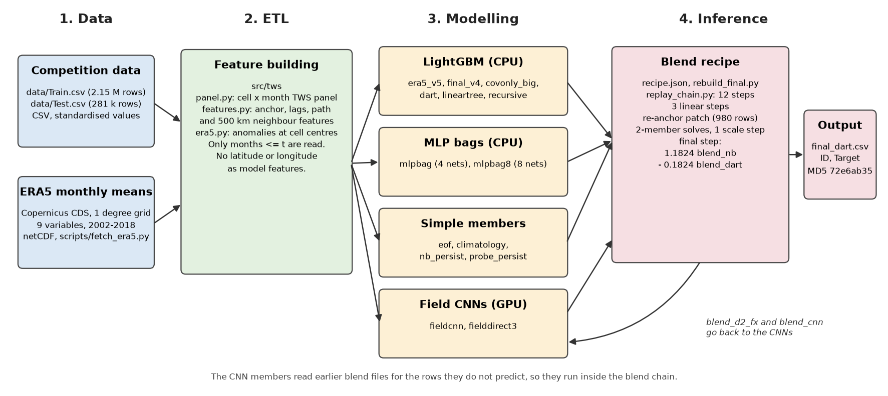

# A Step Ahead of Drought: solution package (team nhatvo)

| | |
|---|---|
| Final submission | Zindi ID `8AUSjdXW`, file `final_dart.csv` |
| Public RMSE | 0.662143042 |
| Private RMSE | 0.700298968 (rank 6) |
| MD5 of the scored file | `72e6ab359311a9ea4fa019947a928503` |

This README follows Zindi's documentation guide section by section. Section 12 maps every point of
Zindi's code-review guide to the place where this package meets it. The trustworthiness report is
`report/PHASE2_REPORT.md` and the long technical report is `report/REPORT.md`. The working log
(`NOTES.md`) is not published.

**To reproduce the scored file, run path A in section 10.**

## 1. Overview and objectives

**The problem.** GRACE satellite estimates of Total Water Storage (TWS) arrive 2 to 3 months late,
which limits their use for drought monitoring. The challenge asks for next-month TWS for every land
cell on a 1 degree grid. The test file has six forecast runs. Each run starts at a month where TWS
is known for every cell, and then TWS is hidden for up to six more months. So the real horizon is
1 to 7 months.

**The solution.** A blend of 14 base prediction files. The main model is one LightGBM regressor for
all leads. It predicts the change from the last observed TWS value (the anchor), using the
supplied covariates and ERA5 reanalysis. The other members are different model types, chosen
because they make different errors: LightGBM variants, MLP bags, simple statistical members and two
small convolutional networks over the global TWS field.

**Objectives and expected outcomes.**
- Forecast TWS 1 to 7 months ahead from data available at the forecast month only.
- Minimise RMSE. Achieved: public 0.662143, private 0.700299, rank 6 of 1,381.
- Make the scored file reproducible byte for byte from the delivered code and member predictions.
- Keep the method reusable for other gridded variables, regions and lead times
  (`report/PHASE2_REPORT.md` section 3).

**Disclosure: the blend weights came from the public leaderboard.** We solved the blend weights
from public leaderboard scores, not from a validation set. The method uses the identity
`E[p*y] = (E[p^2] + E[y^2] - RMSE^2) / 2` (`report/REPORT.md` 3.4 and 7, `NOTES.md` 6.53 to 6.98).
In this package the weights are fixed numbers in the code. Nothing reads the leaderboard. From the
submission `MAUBvhPi` to the final file, 79% of the public gain also appeared on the private board.

## 2. Architecture diagram



`scripts/make_architecture_diagram.py` draws this figure. The two CNN members use an earlier blend
for the rows they do not predict, so they run inside the blend chain, not before it.

## 3. ETL process

### 3.1 Extract

| Source | Format | Volume | How it is extracted | Frequency |
|---|---|---|---|---|
| `data/Train.csv` (competition) | CSV | 2,154,021 rows, 276 MB, 2002-2015 | downloaded from the competition page | once |
| `data/Test.csv` (competition) | CSV | 280,961 rows, 33 MB, 2015-2018 | downloaded from the competition page | once |
| ERA5 monthly means, Copernicus Climate Data Store, dataset `reanalysis-era5-single-levels-monthly-means` | netCDF, 1 degree grid | 34 files (one per year for 9 fields, one per year for snow), 124 MB | `scripts/fetch_era5.py`, one request per year through `cdsapi` | once; operationally monthly |

ERA5 variables: total precipitation, evaporation, runoff, 2 m temperature, snow depth, and
volumetric soil water layers 1 to 4. The download needs a free CDS account and a one-time acceptance
of the CC-BY licence. `fetch_era5.py` skips years already on disk, so a failed run can restart.

- **Availability.** ERA5T, the operational version, appears about five days after the month
  ends, which meets the rule "available within one month of acquisition". Following organiser ruling
  #34403, final ERA5 stands in for ERA5T in past months.
- **No future data.** A row at month t reads ERA5 and TWS only at months up to t.
- **No GRACE-derived data** from any external source. GLDAS was tested and is not used.

### 3.2 Transform

All processing is in code, in `src/tws/`. Nothing is edited by hand.
- `panel.py` reads the CSV files and builds a cell by month TWS panel (NumPy array). Masked TWS
  values stay missing (NaN). They are never filled from later months.
- `features.py` builds, for each row: the anchor (last observed TWS) and its anomaly against the
  cell's own climatology; TWS changes over 1, 2, 3, 6 and 12 months before the anchor; statistics
  of SPEI, soil moisture and ERA5 over the window from the anchor to the target month; and 500 km
  neighbourhood means over a KD-tree graph on the unit sphere.
- `era5.py` samples ERA5 at the cell centres and converts each field to anomalies against its own
  monthly climatology from training months.
- Cleansing: rows with no observed anchor fall back to the cell's last observation before the
  anchor (729 rows). `tws.features.assert_no_coordinates` stops the build if any latitude or
  longitude column reaches the model.

### 3.3 Load

The panels and features are built in memory on each run, as NumPy arrays and pandas frames. Cells
are indexed by position in the panel, and months by offset from the first month. ERA5 panels are
read once and cached in memory (`research/arena_adapter.py`). The model outputs are CSV files with
the columns `ID` and `Target`. The 15 archived prediction files in `members/` have SHA-256
checksums in `members/SHA256SUMS`.

## 4. Data modelling

### 4.1 Models and assumptions

The main assumption is physical. TWS is close to the running total of precipitation minus
evaporation minus runoff, plus water held as snow and in the soil. So recent forcing (ERA5, SPEI,
soil moisture) predicts the next change, and TWS tends to return toward its mean. Neighbouring cells
share weather, so 500 km neighbourhood means carry signal.

Each base member is rebuilt at the git commit that produced it (`members.json`), from a code
snapshot in `snapshots/<commit>/`. A snapshot holds only the files that member imports, plus the
configs it reads. For the code-review guide, its imports were moved to the top, unused imports
were removed and long functions got docstrings. The arithmetic is unchanged; section 7 shows the
rebuilds.

| Member | What it is | Commit |
|---|---|---|
| `era5_v5` | Main model. LightGBM, 75 features, target = change from the anchor | 5336887 |
| `final_v4` | Earlier LightGBM without ERA5, predictions multiplied by 0.92663 | a3775d6 |
| `covonly_big` | LightGBM with all 17 TWS-derived features removed, target = TWS level | b86f2b6 |
| `dart` | LightGBM with DART boosting | 702332f |
| `lineartree` | LightGBM with linear models in the leaves | 702332f |
| `recursive` | LightGBM one-step model, rolled forward over the leads | d3663bd |
| `mlpbag` | 4 MLPs (scikit-learn) on the same 75 features | c1c5e8b |
| `mlpbag8` | 8 MLPs | 274c162 |
| `eof` | Rank-3 EOF (SVD) basis of the TWS field, rolled forward | cc83502 |
| `climatology` | Cell mean for the target calendar month, training months only | f949ddf |
| `nb_persist` | 500 km neighbourhood mean of the anchor | f949ddf |
| `probe_persist` | `era5_v5` with the anchor value on the two runs after the data gap | f949ddf |
| `fieldcnn` | 3-layer CNN over the global field, lead-1 rows | 3727443 |
| `fielddirect3` | One CNN per lead, 27 channels including ERA5, 8 seeds | 6f5060e |

### 4.2 Features: selection, engineering and normalisation

The main model has 75 features in five groups: anchor terms, TWS lags, path statistics of the
covariates, 500 km neighbourhood terms, and seasonal and structural terms (`report/REPORT.md` 3.2).
Latitude and longitude are never features; coordinates only locate neighbours. Features were kept or
dropped by forward-in-time validation rounds (`research/round.py`). The organisers supplied
standardised values. ERA5 fields are converted to anomalies, so they need no further scaling. The
MLPs use the same features.

### 4.3 Training: algorithms, hyperparameters and process

The models train on targets up to 2015-09, except `fieldcnn`, which keeps its default holdout of
the last 24 training months. Seeds are fixed everywhere.

| Model | Hyperparameters |
|---|---|
| LightGBM, all members (`research/arena_adapter.py`) | objective regression, metric rmse, learning_rate 0.05, num_leaves 127, min_data_in_leaf 200, feature_fraction 0.8, bagging_fraction 0.8, bagging_freq 1, lambda_l2 1.0, 300 rounds, 55% of cells sampled (seed 11), seeds 7 |
| `era5_v5` config (`research/champion.json`) | delta target, path and neighbourhood path features, radius 500 km, prediction smoothing 0.5, ERA5 anomalies and paths |
| `covonly_big` | learning_rate 0.03, 900 rounds, level target, TWS-derived features removed |
| `dart` | boosting dart, drop_rate 0.1 |
| `lineartree` | linear_tree true, num_leaves 63 |
| MLP bags (`scripts/submit_mlp.py`) | MLPRegressor, relu, adam, alpha 1e-4, batch 8192, learning rate 1e-3, early stopping with patience 6, 2.5 M sampled rows; `mlpbag` layers (256,128) seeds 7-9 and (512,256,128) seed 7; `mlpbag8` layers (256,128) seeds 7-12 and (512,256,128) seeds 7-8 |
| `fieldcnn` (`research/fieldcnn.py`) | conv 5x5 to 16 channels, conv 3x3 to 16, conv 1x1 to 1, circular in longitude, AdamW learning rate 3e-3, weight decay 1e-3, 30 epochs, seed 0 |
| `fielddirect3` (`research/fielddirect2.py`) | same network, one per lead, 27 input channels, 8 seeds per lead, no holdout |
| `eof` (`scripts/submit_eof.py`) | rank 3, `EOF_LAM` 1.0 |

Evaluation metric: RMSE. Local scores are weighted to the test mix of leads.

### 4.4 Validation

Validation is forward in time. Each fold trains on months before a cut and predicts later anchor
months, as the test set does. Local RMSE is computed per lead and reweighted to the test lead mix
(`report/REPORT.md` 2). Blend weights were then solved from public leaderboard scores (section 1).
The bias tables in `report/artifacts/` come from a forward holdout of 1,450,184 rows (test-weighted
RMSE 0.62792 for the main model). The SHAP values use 40,000 training rows.

## 5. Inference

### 5.1 How the final file is produced

`recipe.json` lists the blend steps, and `rebuild_final.py` runs them in order. Every step repeats
the arithmetic of the original competition code, so the output is identical byte for byte.

- `replay_chain.py` rebuilds 12 files, from `delta108` to `blend_dart`. Each function names the
  original script and uses its constants and public scores. `delta108` is not an archived member,
  so it is rebuilt from the data and `era5_v5`.
- 3 linear steps (`blend_dopt`, `blend_lt`, `blend_d2`) use fixed float64 weights. Their only use is
  the input of the patch step, which rounds to 5 decimals.
- 1 patch step re-anchors 980 rows whose cell reappears inside a run; those rows use the TWS value
  given in their own row, at month t. It applies `members/anchor_patch.csv` when that file is
  present. Otherwise it runs `scripts/fix_anchor.py`.
- 3 two-member solve steps and 1 scale step repeat the original solves, with the recorded public
  scores in `recipe.json`. `recipe.json` also stores the weights these solves gave on the scored
  files (`scored_weights`). With `--scored-weights`, the solve steps apply those weights instead of
  solving again. On the archived members both modes write the same bytes. Path C uses
  `--scored-weights` (section 7 explains why).
- 1 final step computes `1.1824 * blend_nb - 0.1824 * blend_dart`.

Some steps wrote their CSV with 5 decimals, and the next step read that file back. The replay does
the same, so the rounding is identical.

**Fixed constants with an outside origin.** `blend_receof` used two local residual correlations,
`RHO_RECURSIVE = -0.0721684811` and `RHO_EOF = 0.0533735743`, computed from local holdout predictions
just before that blend was written. `MLPBAG8_MEAN_PY = 0.59275` is `E[p*y]` for `mlpbag8`, recovered
from a public score. These values are constants in `replay_chain.py`.

### 5.2 Input and output

- **Input:** `data/Test.csv` and `data/Train.csv` (for the panel), the ERA5 files in `data/era5/`,
  and, for path A, the member files in `members/`.
- **Output:** `final_dart.csv` with the columns `ID` (`YYYYMMDD_lat_lon`) and `Target`, the
  predicted TWS for that cell and month, in the organisers' standardised units.

### 5.3 Deployment, versioning and retraining

The solution runs as batch Python scripts on one workstation. It needs no server or cloud service.
Each member is tied to a git commit, and its code is shipped as `snapshots/<commit>/`. A new month
of data means refitting the members with the training cut moved forward. Operationally there is no
leaderboard, so new blend weights must come from a forward-in-time holdout with known truth
(section 9).

## 6. Run time

Times are on the hardware in section 10. Member times are from the original production runs.

| Script or model | Device | Run time |
|---|---|---|
| `scripts/fetch_era5.py` (ERA5 download) | network | about 28 minutes |
| `era5_v5` | CPU | 3.4 minutes |
| `final_v4` | CPU | 2.1 minutes |
| `covonly_big` | CPU | 5.4 minutes |
| `dart` | CPU | 9.7 minutes |
| `lineartree` | CPU | 6.1 minutes |
| `recursive` | CPU | 1.3 minutes |
| `mlpbag` | CPU | about 3 hours |
| `mlpbag8` | CPU | about 2.5 hours |
| `eof`, `climatology`, `nb_persist`, `probe_persist` | CPU | under 10 seconds each |
| `fieldcnn` | GPU | about 6 seconds |
| `fielddirect3` | GPU | 3.6 minutes |
| `scripts/fix_anchor.py` (re-anchor refit) | CPU | about 4 minutes |
| `replay_chain.py` | CPU | about 30 seconds of CPU time |
| `rebuild_final.py` from the archived members (path A) | CPU | 78 seconds (measured on a shared machine) |
| `rebuild_members.py`, all members (path B) | CPU and GPU | 277 minutes (measured, commit 01e5c2f) |
| `run_all.sh`, raw data to final file (path C) | CPU and GPU | 280 minutes (measured, commit 01e5c2f) |
| `scripts/report_artifacts.py` (bias tables, SHAP) | CPU | about 25 minutes |

## 7. Performance metrics

**Leaderboard.** Public RMSE 0.662143042, private RMSE 0.700298968, private rank 6.

**Model accuracy (local forward holdout, main model).** Test-weighted RMSE 0.62792. RMSE by lead
rises from 0.558 (lead 1) to 0.723 (lead 4). `report/artifacts/bias_tables.md` breaks the error down
by latitude band, variability regime, lead and year. We also tracked the correlation of predictions
with the truth, recovered from public scores, when choosing blend members.

**Reproduction checks.**

| Check | Result |
|---|---|
| **Path A in a clean copy of this package (no git history, no `submission/` folder), after checking `members/SHA256SUMS`** | **`final_dart.csv` MD5 `72e6ab359311a9ea4fa019947a928503`, identical to the scored file, in 62 seconds** |
| **After the code-review clean-up (commit 01e5c2f), in a clean copy** | path A MD5 `72e6ab35...` in 21 seconds; `eof`, `climatology`, `nb_persist`, `probe_persist`, `fieldcnn` and `fielddirect3` rebuilt byte-identical |
| `replay_chain.py`: 12 steps from `delta108` to `blend_dart` | byte-identical |
| Patch, solve and scale steps, and the final step | byte-identical, 0 rows different |
| `eof`, `climatology`, `nb_persist`, `probe_persist` retrained at their commits | byte-identical |
| `fieldcnn` and `fielddirect3` (8 seeds) retrained on the GPU at their commits | byte-identical |
| LightGBM members retrained at their commits | close but not byte-identical: RMS difference `dart` 0.00025, `covonly_big` 0.0014, `era5_v5` 0.0015, `final_v4` 0.0026, `recursive` 0.0084, `lineartree` 0.019 |
| `scripts/fix_anchor.py` rerun | 28 of 980 rows differ, by up to 0.0067; forcing col-wise or row-wise histograms gives 37 and 32 rows |
| `run_all.sh` from raw data in a clean copy of commit 01e5c2f (280 minutes) | `eof`, `climatology`, `nb_persist`, `mlpbag` and `mlpbag8` byte-identical; the other members close. Final file RMS difference 0.030 from the scored file, because the solve steps solved their weights again (see below) |
| Path A with `--scored-weights` | MD5 `72e6ab35...`, identical to the scored file |
| The same retrained members, blend steps from `blend_cnn` onward rerun with `--scored-weights` (`fielddirect3` retrained again on the new `blend_cnn`) | final file RMS difference 0.0039 from the scored file, largest row 0.063, correlation 0.99999 |

**Why path C applies the scored weights.** The public scores in the three solve steps were measured
on the original prediction files. With retrained members, solving again from those scores is badly
conditioned. The `blend_cnn` solve takes `h` of `fieldcnn` from a probe that mixed only 4% of it,
so the solve divides by 0.04, and small changes in the members are multiplied by 25. In the full
retrain, the `blend_cnn` weight moved from 0.604 to 0.473, and the final file moved by RMS 0.030.
Every step before `blend_cnn` stayed within RMS 0.0036. The weights solved on the scored files are
part of the scored model, so `run_all.sh` applies them. The final file then moves by RMS 0.0039.

**Why path A is the exact path.** The 14 base members plus `anchor_patch.csv` are the prediction
files the competition code wrote. The data, the code at each commit and the package versions are
unchanged since those runs. LightGBM training is still not bit-stable from run to run on our
machine, so retraining a LightGBM member gives slightly different predictions. RMSE cannot move by
more than the RMS difference of the files, so the full retrain with scored weights can change RMSE
on the whole test set by at most 0.0039. If the difference is not correlated with the errors, the
expected change is about 0.0039^2 / (2 * 0.70) = 1.1e-5.

## 8. Error handling and logging

- **ETL.** `fetch_era5.py` skips years already downloaded, so a failed download restarts where it
  stopped. `assert_no_coordinates` stops the build if a coordinate reaches the model.
  `fix_anchor.py` asserts that every re-anchored month is observed and every prediction is finite.
- **Modelling.** `rebuild_members.py` writes one log per member to `output/logs/`, reports a failed
  member with its exit code, and continues with the next one. It compares each output with the
  archive in `output/rebuild_members_report.json`.
- **Inference.** `rebuild_final.py` stops at the first failed step. `--resume` skips finished steps,
  and `--until` stops at a named step. `--check` compares each step with `submission/<step>.csv`.
  `replay_chain.py --check` prints `ALL IDENTICAL` or the steps that differ, and exits with status 1
  on a difference.
- **Energy.** CodeCarbon records each member run in `output/emissions.csv`, and the research runs in
  `research/emissions.csv`.

## 9. Maintenance and monitoring

- **Monitoring.** Track RMSE by lead and by latitude band every month. `scripts/report_artifacts.py`
  produces these tables. Watch the anchor rows: the error grows with the months since the last
  observation.
- **Updating the data.** Run `fetch_era5.py` for new months, then refit the members with the
  training cut moved forward. The features read only months up to the forecast month, so no code
  change is needed.
- **Updating the models.** Build the Gram matrix of the members and their products with the truth
  on a forward holdout, then solve with bounds as in `research/lb_solve.py`. That script reads
  leaderboard scores, so the moments must come from the holdout instead.
- **Scaling.** Feature building is vectorised over cells, so a finer grid or more regions scale
  roughly with the number of cells. The CNNs have the same number of weights at any grid size. The MLP bags
  are the slowest part; fewer nets, or nets trained in parallel, cut most of the run time.
- **Lifecycle.** Each member is a git commit plus a code snapshot, and each blend step is recorded
  in `recipe.json`. A change to one member means rebuilding it and the blend steps after it.

## 10. How to run

**Environment used.** Ubuntu 24.04.3, Linux 7.0, Python 3.12.3. Intel Core i7-10700 (16 threads),
31 GB RAM. NVIDIA GeForce RTX 3070 (8 GB), driver 580.173.02, CUDA 13.2. Only free, open-source
packages are used, listed with versions in `requirements.txt`. `codecarbon`, `xarray` and
`netCDF4` are required, not optional: the code imports them at the top of its modules.

Run everything from the repository root, with the competition data in `data/`:

```bash
python3.12 -m venv .venv
.venv/bin/pip install -r submission_model/requirements.txt --extra-index-url https://download.pytorch.org/whl/cu132
.venv/bin/python scripts/fetch_era5.py      # only for paths B and C
```

**A. Rebuild the scored file from the archived members (exact).**

The archived members (`submission_model/members/*.csv`) are not in the public repository, because
they are derived from the competition test data. Path A needs them.

```bash
.venv/bin/python submission_model/rebuild_final.py
md5sum submission_model/output/final_dart.csv   # 72e6ab359311a9ea4fa019947a928503
```

**B. Retrain the base members and compare them with the archive.**

```bash
.venv/bin/python submission_model/rebuild_members.py               # all members
.venv/bin/python submission_model/rebuild_members.py eof fieldcnn  # some members
```

**C. The whole pipeline from raw data.**

```bash
submission_model/run_all.sh
```

Path C retrains every member, then runs the blend steps with `--scored-weights`. LightGBM training
is not bit-stable, so path C gives a file very close to the scored file, but not byte-identical:
RMS difference 0.0039 in our run (section 7). It takes about 5 hours on the hardware above.

## 11. Data insights

`report/REPORT.md` explains what we learned about the data and the models, including the negative
results. `scripts/report_artifacts.py` produces the error decomposition
(`report/artifacts/bias_tables.md`) and the SHAP figure and table (`report/artifacts/`). The main
findings: error is highest at 15 to 30 degrees north and lowest at 30 to 60 degrees north; skill
falls as the gap between training and forecast grows; and ERA5 forcing carries the largest share of
SHAP importance (30%).

## 12. Code-review guide checklist

| Guide point | Where this package meets it |
|---|---|
| Set random seeds | Section 4.3. Path A reproduces the scored file exactly (section 7). |
| Library versions in `requirements.txt` | `requirements.txt`, only packages the code uses |
| Imports at the top, only used libraries | Every shipped Python file imports at the top and only what it uses: the package scripts, the files they import, and the member code in `snapshots/`. An automatic check of the 103 shipped Python files finds no import inside a function and no unused import. |
| Coding environment | Section 10 |
| Data used and its source | Section 3.1 |
| All data processing in code | Sections 3.2 and 3.3. Nothing is edited by hand; the archived members are outputs of the code. |
| Only freely available packages | Section 10. ERA5 needs only a free CDS account. |
| Repeated code as named functions, clear names, comments | `replay_chain.py`, `rebuild_final.py` and `rebuild_members.py` use named helper functions and descriptive names. Every long function in the shipped code has a docstring, and no variable is named `tmp`. Comments follow the article the guide links. |
| Data insights | Section 11 |
| The code runs | Path A was run in a clean copy of the package without git history (section 7). |
